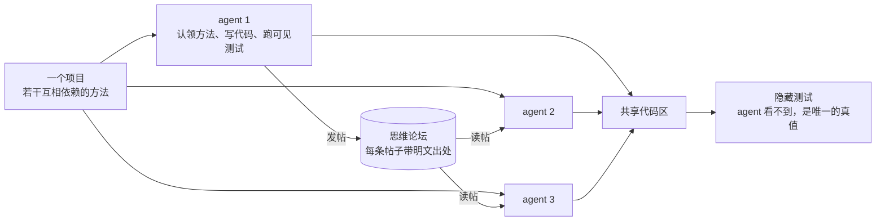
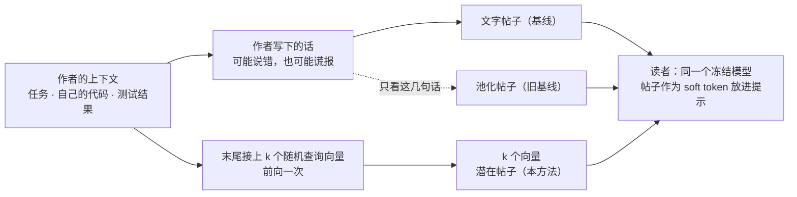
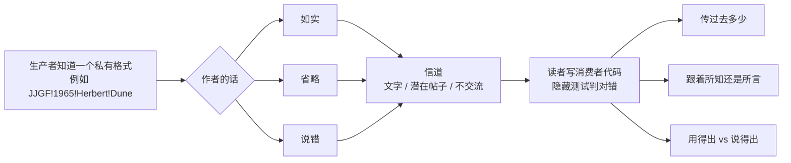

# ThoughtForum

让一群互不信任的 LLM agent 通过一个共享的"思维论坛"交流，一起把同一个软件项目做完，并弄清楚：从作者上下文里直接读出来的潜在信号，能传递什么、能不能帮读者核对同伴的说法、又会带来哪些风险。

## 这件事为什么有意思

足够强的 agent 已经能分工协作，但交流里一直有个老问题：agent **说**它做了什么，和它**实际**做了什么，常常对不上。有时是能力不够，有时是急于完成。这些不实的说法会沿着上下文传给同伴，一层层传下去。

我们说的**零信任**，并不是不让 agent 说话，而是：照常交流，但不默认相信任何一条说法。看到同伴说"做完了"或者"接口是这样的"，先主动核对，再拿来用。

难点在于拿什么核对：
- 重新跑测试，只能覆盖测试写到的部分；
- 让同伴写测试来验证，测试本身也常常是错的（我们测到 77%）。

于是我们想看另一种信号：不经过作者的嘴，直接从作者的上下文里读出来的潜在向量。它跟着作者"知道的"走，还是跟着作者"说的"走？它能不能帮读者核对说法，甚至把信息传过去？

## 一次协作是什么样的



agent 没有预设角色，自己挑还没完成的方法来做。做完之后在论坛上留一条帖子，其他人写代码时会读到相关的帖子。最后用 agent 看不到的隐藏测试判断项目到底做对了多少。

## 方法：一条帖子怎么来



作者写帖子的时候，它知道的东西都已经在上下文里了。我们在这段上下文末尾接上 k 个随机的词表向量作为查询，让模型再跑一次前向，取这 k 个位置的末层状态，映射回输入空间，得到一条潜在帖子。

整个过程**不训练任何参数**，多出的开销只是 k 个位置的一次前向。和 LatentMAS、KV 共享、C2C 等方法的区别见 [`doc/method.md`](doc/method.md)。

## 怎么测：SecretBench



要测一条消息传了多少信息，这条信息最好是猜不出来的，对错也能客观判定。

所以我们造了 SecretBench。每个项目里，生产者 `encode` 按一个随机生成的私有格式写记录。三个消费者方法必须知道这个格式才能写对，而它们的文档和可见测试都不透露格式，只能从帖子里得知。

详见 [`doc/benchmark.md`](doc/benchmark.md)。

## 目前看到的现象

以下都是初步结果：只用了一个模型（Qwen3-8B）、一个随机种子、几十个项目。

| 现象 | 证据 |
|---|---|
| **潜在信号跟着作者知道的走，而不是作者说的。** 所以它有望成为核对说法的证据，但也会泄露作者没说的东西 | 作者谎称"做完了"时，原版读者从训练过 writer 的帖子里读出真实测试结果的准确率是 0.94，换成别人的帖子是 0.48；线性探针区分谎言和真话 0.91，只看文字 0.71 |
| **但冻结的读者读不出其中的具体内容。** 不管是池化作者的话，还是从整个上下文读出来，免训练的潜在帖子都传不过私有格式；附在文字旁边，读者照样跟着文字走 | 消费者通过率：只给潜在帖子 0.02 左右，文字 0.66；作者把格式说错时，85% 的读者照着错的写，附上潜在帖子后仍有 84–93% |
| **绕过作者的嘴，文字证据也更准。** 直接把代码和测试日志贴上论坛，比作者自己写的汇报传得更多，团队谎报完成也更少，只是更贵 | 论坛里跨 agent 的消费者通过率：贴代码 0.68，作者汇报 0.48，潜在帖子 0.01，不交流 0；团队宣布完成、隐藏测试却不过：0.30 对 0.83；提示 token 多 1.7 倍 |
| **在任务上训练写入端，会收成模板** | 训练后读者写出格式规整、标签却错的记录，例如 `'PZQX~1965~Herbert~Dune'`（真值是 `'JJGF!1965!Herbert!Dune'`） |

> 更正：之前这里写过"零训练的潜在帖子比文字传得更准""读者用得出、说不出"，那来自评测代码的一个 bug（读者实际收到的是文字），已撤回。详见研究笔记的 R13。

完整的实验记录（R1–R15）见 [`doc/research_notes.md`](doc/research_notes.md)。

## 仓库里有什么

```
model/        方法本身：后端（mock / 本地 HF 模型 / API）、潜在帖子的写法（writers）
benchmark/    SecretBench 与 ClassEval 任务、共享代码区、测试沙箱、基于执行的评测
forum/        多 agent 论坛：调度、单个 agent 的工作流程、帖子与出处、提示词、指标
training/     训练类的消融实验（读取侧 adapter、writer head）
analysis/     结果分析：对比表、配对检验、线性探针、SecretBench 专用统计
experiments/  每个实验一个脚本，本地用 bash 跑，集群上用 sbatch 提交
data/         ClassEval 数据（FudanSELab，MIT 许可），以及我们筛过的可用类
tests/        单元测试
doc/          研究计划、方法、基准、代码导览、完整研究笔记
literature/   文献索引（707 篇）与离线浏览页
runs/         实验输出（不入库）
```

每个文件做什么，见 [`doc/code_guide.md`](doc/code_guide.md)。

## 跑起来

**准备环境。** 推荐 Python 3.11：

```bash
git clone https://github.com/jwj1342/ThoughtForum.git && cd ThoughtForum
python -m venv .venv && source .venv/bin/activate
pip install -r requirements.txt
python -m unittest discover -s tests -t .
```

mock 后端、API 后端和大部分测试只用标准库，所以如果暂时只想看看流程，`pip install` 那一步可以先跳过。

**先用 mock 后端看一遍流程。** 不加载任何模型：

```bash
python -m forum.run --backend mock --tasks toy --grid channel=none,text,latent --out runs/demo
```

**用本地模型。** 潜在帖子要读模型的隐状态，所以需要把模型放在本地。我们自己用的是一张 40GB 的 GPU 切片，但这不是硬性要求：
- Qwen3-8B 的权重约 16GB（bf16），一张 20–24GB 显存的卡跑推理一般就够了；
- 显存更小，可以换同系列的 Qwen3-4B 或 Qwen3-1.7B；
- 训练类的消融实验要对整个模型反传，显存需求会高一些。

`--model` 可以写本地路径，也可以直接写 HuggingFace 上的名字，第一次运行时会自动下载：

```bash
export LF_MODEL=Qwen/Qwen3-8B        # 或者本地路径
python -m forum.run --backend hf --tasks secret:40 --spec private --memory true \
    --channel latent --writer-head random:16 --out runs/method
```

`--writer-head random:16` 就是本方法；把它换成 `--channel text` 就是文字基线。

**用 API。** 没有 GPU 也可以接任何兼容 OpenAI 接口的服务，例如 OpenAI、阿里云百炼上的千问、本地的 vLLM 或 Ollama，跑文字基线和不交流的条件。API 拿不到隐状态，所以跑不了潜在帖子。

key 从环境变量读取，不会写进配置或日志：

```bash
export LF_API_KEY=你的key            # 换成别的变量名可以用 --api-key-env
python -m forum.run --backend api --model qwen3-8b \
    --api-base https://dashscope.aliyuncs.com/compatible-mode/v1 --api-extra '{"enable_thinking": false}' \
    --tasks secret:40 --spec private --memory true --channel text --out runs/api_text
```

本地的 vLLM 一般不需要 key，把 `--api-base` 换成 `http://localhost:8000/v1` 即可。

**跑完整实验。** `experiments/` 里每个脚本对应一个实验，在仓库根目录运行：

```bash
bash experiments/smoke.sh                              # 本地：用真模型把每个入口都简短跑一遍
sbatch --account=<你的账户> experiments/e0s3.sh          # 有 Slurm 的集群上
```

个人的设置（模型路径等）写在 `experiments/local.sh` 里，这个文件不会入库。在 Alliance（Compute Canada）的集群上，脚本会自动改用模块系统和 wheelhouse。

## 接下来

- 把离线基准补全：加上"说错"的汇报、可调的信息量。
- 和已有通信方法正面比较：文字、贴代码、共享完整上下文、隐状态池化、LatentMAS、激活合并、训练过的压缩器。
- 画两条曲线：信息量 × 向量数的容量曲线；同时在场的帖子数从 1 增加到 16 时的干扰曲线，这条对应"一大群"。
- 做因果分析：把别人的帖子移植过来，只改作者上下文而不改它的话，按层消融。
- 在第二个模型上复现。

## 文档

- [`doc/RP.md`](doc/RP.md)：研究计划，一句话加简短展开。
- [`doc/method.md`](doc/method.md)：方法。
- [`doc/benchmark.md`](doc/benchmark.md)：测量基准。
- [`doc/code_guide.md`](doc/code_guide.md)：代码导览、实验开关、输出与实验脚本。
- [`doc/research_notes.md`](doc/research_notes.md)：完整研究笔记，包括文献判断、设计取舍、R1–R15 实验记录、现象与风险。
- [`literature/`](literature/)：文献索引，用浏览器打开 `literature/literature_review.html` 即可离线浏览。论文 PDF 不入库，可用 `literature/tools/fetch_pdfs.py` 重新下载。
