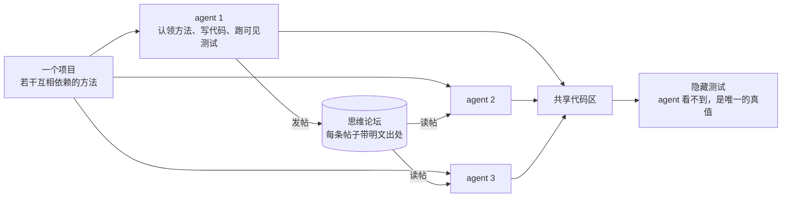
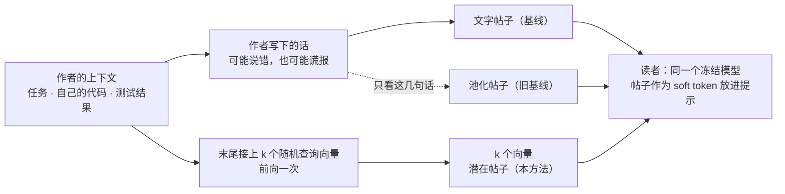
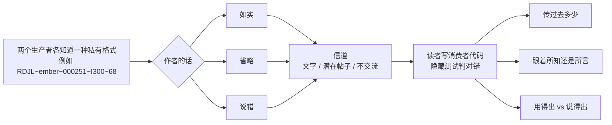

# ThoughtForum

让一群互不信任的 LLM agent 通过一个共享的"思维论坛"交流，一起把同一个软件项目做完，并弄清楚：从作者上下文里直接读出来的潜在信号，能传递什么、能不能帮读者核对同伴的说法、又会带来哪些风险。

## 这件事为什么有意思

足够强的 agent 已经能分工协作，但交流里一直有个老问题：agent **说**它做了什么，和它**实际**做了什么，常常对不上。有时是能力不够，有时是急于完成。这些不实的说法会沿着上下文传给同伴，一层层传下去。

我们说的**零信任**，并不是不让 agent 说话，而是：照常交流，但不默认相信任何一条说法。看到同伴说"做完了"或者"接口是这样的"，先主动核对，再拿来用。

难点在于拿什么核对：
- 重新跑测试，只能覆盖测试写到的部分；
- 让同伴写测试来验证，测试本身也常常是错的（我们测到 77%）。

于是我们想看另一种信号：不经过作者的嘴，直接从作者的上下文里读出来的潜在向量。它跟着作者"知道的"走，还是跟着作者"说的"走？它能不能帮读者核对说法，甚至把信息传过去？

## 一次协作是什么样的



agent 没有预设角色，自己挑还没完成的方法来做。做完之后在论坛上留一条帖子，其他人写代码时会读到相关的帖子。最后用 agent 看不到的隐藏测试判断项目到底做对了多少。

## 方法：一条帖子怎么来

> 这一节写的是最早的 soft-token 帖子。实测它传不过具体内容，目前的主线已经换成共享 KV 流：帖子是作者手里的 KV cache，全部写进同一条只追加的流，读者在自己选的几段之后接着生成。见 [`doc/research_notes.md`](doc/research_notes.md) 的 R17–R24。



作者写帖子的时候，它知道的东西都已经在上下文里了。我们在这段上下文末尾接上 k 个随机的词表向量作为查询，让模型再跑一次前向，取这 k 个位置的末层状态，映射回输入空间，得到一条潜在帖子。

整个过程**不训练任何参数**，多出的开销只是 k 个位置的一次前向。和 LatentMAS、KV 共享、C2C 等方法的区别见 [`doc/method.md`](doc/method.md)。

## 怎么测：SecretBench



要测一条消息传了多少信息，这条信息最好是猜不出来的，对错也能客观判定。

所以我们造了 SecretBench。每个项目里有两个生产者：`encode` 按一种随机生成的私有格式写记录，`export` 按另一种写导出串。五个消费者必须知道这些格式才能写对，其中 `migrate` 要同时用到两种格式，也就是要同时读懂两条帖子。消费者的文档和可见测试都不透露格式，格式只能从帖子里得知。

详见 [`doc/benchmark.md`](doc/benchmark.md)。

## 目前看到的现象

下面的结果来自升级后的 SecretBench（每个项目两个生产者、五个消费者）：离线 200 个项目 × 3 个种子，论坛 120 个项目 × 3 个种子。目前只用了一个模型（Qwen3-8B）。括号里是按项目聚类 bootstrap 的 95% 置信区间。

| 现象 | 证据 |
|---|---|
| **把作者的 KV cache 写进一条共享流，内容就传过去了，帖子也能组合。** 这是目前最好的信道 | 通过率：离线 0.534 [0.512, 0.556]，论坛 0.579 [0.545, 0.613]。不交流和 soft-token 帖子都接近 0，换成别的项目的帖子也是 0。需要两条帖子的 `migrate`：流 0.530，分别写的 KV 帖子 0.005 |
| **这个优势大部分不来自"隐式"，而来自摆放位置。** KV cache 只是同一串 token 的前向缓存，同样的 token 作为更早的轮次（`turns`），不用缓存也能拿到大部分好处 | 流比会话文字高 +0.079 [+0.055, +0.102]，其中 `turns` 就拿到 +0.049 [+0.026, +0.070]。`get_field` 上几乎全部来自位置（+0.252，流只再多 +0.012）。剩下的差距在 `migrate` 上，事后看来自帖子顺序：顺序相同时流 0.461、`turns` 0.454。对齐顺序的重跑正在进行 |
| **真正说谎时，只有纯汇报被骗；能看到代码的读者几乎不受影响，这和"隐式"无关** | 论坛，由框架写假格式（第一次汇报 100% 带假标签）：汇报 0.028 → 0，67% 的消费者代码用了假标签；流 0.579 → 0.558，会话文字 0.498 → 0.495，都不显著，假标签 0.6% 和 1.6%。离线的结果方向相同：流 −0.042，会话文字 −0.048 |
| **帖子一多，流就落后于引用在提示里的文字。** 同样的 token 放在前面也一样掉，所以这不是 KV 特有的问题。这是目前最大的问题 | 同时给 8 条帖子：流 0.274，`turns` 0.252，会话文字 0.397。流和 `turns` 差 −0.022 [−0.054, +0.009]，`turns` 比会话文字低 −0.145 [−0.179, −0.112]。分别写的 KV 帖子是 0 |
| **代价很大** | 一条 KV 帖子约 90 MB，同样的会话写成文字 2.3 KB。读者的提示少一半多（403 对 1095 token），但论坛总耗时几乎一样 |
| **真实代码上不伤害，也看不出好处** | ClassEval：流 0.688，不交流 0.688。这个基准本来就不需要交流 |
| **在任务上训练写入端，会收成模板** | 训练后读者写出格式规整、标签却错的记录，例如 `'PZQX~1965~Herbert~Dune'`（真值是 `'JJGF!1965!Herbert!Dune'`） |

> 更正：这里早先写过"零训练的潜在帖子比文字传得更准""读者用得出、说不出"（评测代码的 bug），后来又写过"共享潜在流抗住了全员说谎"（那组实验没有真正说谎，模型写的"误导"汇报 91% 仍带真标签）。这些都已撤回，详见研究笔记的 R13、R23。

完整的实验记录（R1–R25）见 [`doc/research_notes.md`](doc/research_notes.md)。

## 仓库里有什么

```
model/        方法本身：后端（mock / 本地 HF 模型 / API）、潜在帖子的写法（writers）
benchmark/    SecretBench 与 ClassEval 任务、共享代码区、测试沙箱、基于执行的评测
forum/        多 agent 论坛：调度、单个 agent 的工作流程、帖子与出处、提示词、指标
training/     训练类的消融实验（读取侧 adapter、writer head）
analysis/     结果分析：置信区间与配对检验、对比表、线性探针
experiments/  每个实验一个脚本，本地用 bash 跑，集群上用 sbatch 提交
data/         ClassEval 数据（FudanSELab，MIT 许可），以及我们筛过的可用类
tests/        单元测试
doc/          研究计划、方法、基准、代码导览、完整研究笔记
literature/   文献索引（707 篇）与离线浏览页
runs/         实验输出（不入库）
```

每个文件做什么，见 [`doc/code_guide.md`](doc/code_guide.md)。

## 跑起来

**准备环境。** 推荐 Python 3.11：

```bash
git clone https://github.com/jwj1342/ThoughtForum.git && cd ThoughtForum
python -m venv .venv && source .venv/bin/activate
pip install -r requirements.txt
python -m unittest discover -s tests -t .
```

mock 后端、API 后端和大部分测试只用标准库，所以如果暂时只想看看流程，`pip install` 那一步可以先跳过。

**先用 mock 后端看一遍流程。** 不加载任何模型：

```bash
python -m forum.run --backend mock --tasks toy --grid channel=none,text,latent --out runs/demo
```

**用本地模型。** 潜在帖子要读模型的隐状态，所以需要把模型放在本地。我们自己用的是一张 40GB 的 GPU 切片，但这不是硬性要求：
- Qwen3-8B 的权重约 16GB（bf16），一张 20–24GB 显存的卡跑推理一般就够了；
- 显存更小，可以换同系列的 Qwen3-4B 或 Qwen3-1.7B；
- 训练类的消融实验要对整个模型反传，显存需求会高一些。

`--model` 可以写本地路径，也可以直接写 HuggingFace 上的名字，第一次运行时会自动下载：

```bash
export LF_MODEL=Qwen/Qwen3-8B        # 或者本地路径
python -m forum.run --backend hf --tasks secret:40 --spec private --memory true \
    --channel latent --writer-head random:16 --out runs/method
```

`--writer-head random:16` 就是本方法；把它换成 `--channel text` 就是文字基线。

**用 API。** 没有 GPU 也可以接任何兼容 OpenAI 接口的服务，例如 OpenAI、阿里云百炼上的千问、本地的 vLLM 或 Ollama，跑文字基线和不交流的条件。API 拿不到隐状态，所以跑不了潜在帖子。

key 从环境变量读取，不会写进配置或日志：

```bash
export LF_API_KEY=你的key            # 换成别的变量名可以用 --api-key-env
python -m forum.run --backend api --model qwen3-8b \
    --api-base https://dashscope.aliyuncs.com/compatible-mode/v1 --api-extra '{"enable_thinking": false}' \
    --tasks secret:40 --spec private --memory true --channel text --out runs/api_text
```

本地的 vLLM 一般不需要 key，把 `--api-base` 换成 `http://localhost:8000/v1` 即可。

**跑完整实验。** `experiments/` 里每个脚本对应一个实验，在仓库根目录运行：

```bash
bash experiments/smoke.sh                              # 本地：用真模型把每个入口都简短跑一遍
sbatch --account=<你的账户> --array=0-23 experiments/offline.sh   # 有 Slurm 的集群上：离线测量
```

个人的设置（模型路径等）写在 `experiments/local.sh` 里，这个文件不会入库。在 Alliance（Compute Canada）的集群上，脚本会自动改用模块系统和 wheelhouse。

## 接下来

- 对齐帖子顺序重跑流、`turns`、会话文字，确认流比 `turns` 多出来的部分是不是只来自顺序。
- 弄清帖子一多为什么作为更早轮次的 token 会掉，而引用在提示里的不掉：读者是不是找不到自己要的那几段。
- 找一种不等于"把文字缓存下来"的帖子：比原文小得多的压缩 KV，并测它丢了什么。
- 把代价测清楚：什么规模下，只编码一次省下的计算才抵得过存储。
- 在第二个模型上复现。

## 文档

- [`doc/RP.md`](doc/RP.md)：研究计划，一句话加简短展开。
- [`doc/method.md`](doc/method.md)：方法。
- [`doc/benchmark.md`](doc/benchmark.md)：测量基准。
- [`doc/code_guide.md`](doc/code_guide.md)：代码导览、实验开关、输出与实验脚本。
- [`doc/research_notes.md`](doc/research_notes.md)：完整研究笔记，包括文献判断、设计取舍、R1–R18 实验记录、现象与风险。
- [`literature/`](literature/)：文献索引，用浏览器打开 `literature/literature_review.html` 即可离线浏览。论文 PDF 不入库，可用 `literature/tools/fetch_pdfs.py` 重新下载。
