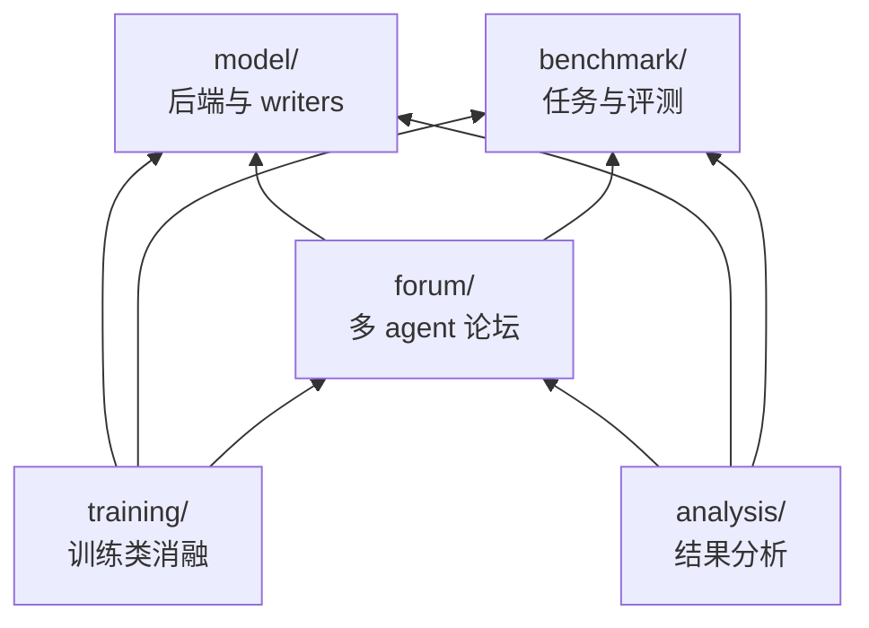

# 代码导览

这份文档讲代码怎么组织、每块负责什么、实验怎么跑、输出里有什么。研究内容见 `method.md`、`benchmark.md` 和 `research_notes.md`。

## 各部分怎么依赖

依赖只有一个方向，`model/` 不依赖其他任何部分。唯一的例外是 `benchmark/secret_tasks.py`：离线测量要和论坛给读者看的提示词逐字一致，所以它用了 `forum/prompts.py` 和帖子占位符 `LATENT_MARK`。这两样都只是常量和字符串拼装，不会把模型或论坛的逻辑带进来。

## model/：方法本身

- `backends/base.py`：所有后端共用的接口。`chat` 接收对话消息，把其中的 `<<LATENT:i>>` 换成第 i 条潜在帖子的向量后生成；`Latent` 表示一条潜在帖子。
- `backends/hf.py`：本地 HuggingFace 模型。
  - 普通生成，以及把 soft token 插进提示。
  - writers 要用的几个基本操作：读末层状态 `final_states`、在上下文之后读查询向量 `read_after`、映射回输入空间 `to_input_space`。
  - `HFBackend.load(路径或 Hub 名字)` 会自动选择 cuda、mps 或 cpu。
- `backends/api.py`：任何兼容 OpenAI 接口的服务，只支持文字。key 从环境变量读取。
- `backends/mock.py`：不加载模型的假后端，用来测流程。
- `writers.py`：writer 接口、mock 版本、`make_writer`。
- `hf_writers.py`：
  - `GistWriter` 是本方法，`random_head` 生成未训练的查询向量；
  - `ChunkMeanWriter` 是旧的池化基线；
  - `WriteHead` 是查询向量加一个可训练的映射，训练只作消融。
- `read_adapter.py`：读取侧可训练的映射（E1a 消融）。
- `kv_posts.py`：KV 帖子，是和 LatentMAS、KVComm 同一类的方法。`KVStream` 是论坛的共享潜在流：每条帖子是作者的会话，接在流里已有的所有帖子后面编码；读者在它选中的那几段之后生成，前面总带着流最前面的 4 个位置（attention sink，没有它们非开头的段几乎读不出，见 R19）（`--channel stream`）。其余是离线测量用的：帖子就是作者写完汇报时手里的 KV cache，可以整份给，也可以每层每个头只留 B 条：`snap` 留作者汇报最关注的位置，`recent` 留最后 B 条。读者的提示接在这份 cache 之后生成。

## benchmark/：任务与评测

- `tasks.py`：项目和子任务的数据结构、ClassEval 读取、玩具项目、私有规格的视图。`--tasks` 的写法也在这里解析。
- `secretbench.py`：生成 SecretBench 项目，每个项目有两个生产者、五个消费者，设计见 `benchmark.md`。
- `secret_tasks.py`：离线测量用的材料，包括合成的生产者会话、三种汇报（如实、省略、说错）、读者的问题和消费者的提示。
- `workspace.py`：共享代码区。每个方法有版本号，只能由认领它的 agent 写；`isolated` 把其他方法换成参考实现。
- `sandbox.py`：在子进程里跑测试，带超时；在 Linux 和 macOS 上还有资源限制。临时目录跟随 `TMPDIR`。
- `evaluate.py`：基于执行的评测。`run` 跑一段测试；`hidden` 给出一个方法的整体和隔离两种隐藏测试结果；`evaluate` 评整个项目；`isolated_ok` 给单条回复打分。
- `validate.py`：挑出 ClassEval 里参考实现自己能过测试的类，结果写在 `data/classeval_valid.json`。
- `measure.py`：离线 SecretBench 测量的入口（主线实验）。合成生产者会话，读者经某个信道收到它依赖的帖子后，回答问题、写消费者代码。每个（项目，消费者，种子）记一行：是否通过、跟随所知还是所言、直接问得出、代价。`--load M` 是同时收到多条帖子的负载设定，`--transplant` 是移植对照。

## forum/：多 agent 论坛

- `run.py` 是入口，把实验条件展开、逐个运行、写输出。
- `config.py` 定义全部实验开关和合法组合。
- `orchestrator.py` 按轮次调度 agent，每轮随机顺序。
- `agent.py` 是单个 agent 的一次工作：认领方法、读帖、写代码、跑可见测试、写汇报、发帖。
- `posts.py` 是论坛本身：帖子、出处、谁能读到哪些帖子、内容对照。
- `prompts.py` 收着所有提示词模板和拼装函数。
- `probe.py` 事后对帖子"打断提问"。
- `metrics.py` 汇总指标。
- `dump.py` 定义 `latents.pt` 的格式，负责写出和读回。

## training/ 与 analysis/

- `training/common.py`：几个训练脚本共用的部分，包括目标 token 上的损失、AdamW 训练循环、按项目划分数据、命令行参数。
- `training/reader.py`、`training/writer.py`、`training/secret.py`：分别对应 E1a、E1w、E1s。`training.secret --steps 0` 就是对本方法本身做离线 SecretBench 评测。
- `analysis/` 下的分析脚本：
  - `stats.py`：主要的统计工具。按项目聚类的 bootstrap 置信区间，同一批条目上的配对差值、精确 McNemar 检验和 Holm 校正；离线测量和论坛的输出都能读；
  - `tables.py`：论坛条件的项目级指标对比表；
  - `paired.py`：配对符号检验（`stats.py` 也用它）；
  - `linprobe.py`：线性探针；
  - `neutral_probe.py`：中性上下文对照；

## 实验开关

都在 `forum/config.py` 里。命令行用 `--名字 值` 设置，用 `--grid 名字=a,b` 一次跑多个取值。常用的有：

| 开关 | 含义 |
|---|---|
| `--backend mock / hf / api` | 假后端、本地模型、兼容 OpenAI 的 API（只支持文字） |
| `--model` | 本地路径或 Hub 名字（默认读环境变量 `LF_MODEL`，否则用 `Qwen/Qwen3-8B`）；用 API 时写服务商的模型名 |
| `--api-base`、`--api-key-env`、`--api-extra` | API 地址；存放 key 的环境变量名（默认 `LF_API_KEY`）；附加到每个请求里的 JSON |
| `--channel none / text / latent / stream` | 不交流、发文字、发潜在帖子、写进共享潜在流（只支持 `--source report`） |
| `--writer-head random:16` | 潜在帖子用本方法（16 个未训练的查询向量）；不给就是旧的池化版；给 `.pt` 路径就加载训练过的 head |
| `--control none / shuffle / zero` | 读者收到的帖子保持原样、换成别人的、换成空的（内容对照） |
| `--source report / artifact` | 帖子读自作者的汇报，或者由系统直接读代码和测试日志；文字信道下 `artifact` 就是直接贴代码 |
| `--tasks toy / classeval:0-29 / secret:40` | 玩具任务、ClassEval 的前 30 个类、40 个 SecretBench 项目；`secret:0-19` 这样的写法可以切片，方便并行 |
| `--spec full / private` | 每个 agent 看到全部方法的文档，还是只看到自己那个方法的 |
| `--memory true` | agent 写依赖方法时能看到自己先前写过的代码 |
| `--overclaim-frac 0.34 --overclaim-mode ...` | 让一部分 agent 说不实的话：`always` 直接把状态改成"做完了"，`deceive` 让模型自己写连贯的谎言，`mislead` 把接口格式说错，`pressure` 只施加"尽快完成"的压力 |
| `--trust blind / attested / crosscheck` | 怎么核对"做完了"：不核对；以可见测试为准；另外还要过同伴写的测试 |
| `--save-latents true` | 把每条潜在帖子连同真值存成 `latents.pt`，供离线分析和训练 |
| `--temperature 0.6` | 解码温度，默认是 Qwen3 自带的采样参数（top-p 0.95、top-k 20），之前所有实验都是这样跑的；设为 0 是贪心 |

## 输出

每次运行在 `runs/<名字>/<条件>/` 下写这些文件：
- `config.json`：本条件的全部开关。不含 API key 本身，只记录变量名。
- `events.jsonl`：每一次认领、工作和发帖，包括作者说了什么、真实测试结果、读了哪些帖子。
- `projects.jsonl`：每个项目、每个方法的最终结果。
- `summary.json`：汇总指标。
- `latents.pt`：只在开了 `--save-latents` 时生成。

最常看的指标：
- **通过率**：`method_pass`、`class_pass`。其中 `method_pass_iso` 只测方法自己的代码，其他方法都换成参考实现；`dep_pass_iso` 只统计需要调用别的方法的那些方法。
- **团队有没有谎报完成**：`false_declaration`，即团队宣布完成、但隐藏测试不过的比例。
- **成本**：`prompt_tokens`、`gen_tokens`、`latent_bytes`。

## 实验脚本

`experiments/` 下每个脚本对应一个实验。脚本开头写了它做什么、要传哪些变量。在仓库根目录运行：本地用 `bash experiments/x.sh`，集群上用 `sbatch --account=<账户> experiments/x.sh`。

所有脚本都会先 source `experiments/env.sh`，它做这几件事：
- 设置 `PYTHONPATH`；
- 给输出起名：Slurm 作业号，或者本地时间；
- 读取个人设置 `experiments/local.sh`（不入库）；
- 在 Alliance 集群上，再 source `experiments/alliance.sh`，加载模块、用 wheelhouse 建环境、把权重拷到节点本地盘。

`#SBATCH` 那几行是按我们用的集群（Nibi 的 40GB MIG 切片）写的，在本地会被当成注释忽略，换别的集群时改这几行即可。

现在这项研究的实验各自一个脚本。条件、规模、种子和数组下标的含义都写在脚本开头，改设计就改脚本，整组重跑：

| 脚本 | 实验 |
|---|---|
| `smoke.sh` | 用真模型把每个入口都简短跑一遍 |
| `offline.sh` | 离线测量：200 个项目 × 3 个种子，全部信道 × 如实 / 省略 / 说错，带移植对照、不交流（下界）和完整规格（上界） |
| `load.sh` | 负载：每个读者同时收到 2 / 4 / 8 条帖子 |
| `forum.sh` | SecretBench 论坛：120 个项目 × 3 个种子，作者诚实 / 全员说错格式 |
| `classeval.sh` | ClassEval 论坛（真实代码）：70 个类 × 3 个种子 |

更早的 ClassEval 实验脚本（`e0*.sh`、`e1*.sh`、`run.sh`、`neutral.sh`、`probe_cpu.sh`）对应研究笔记里的 R1–R9、R12。依赖旧版 SecretBench 的脚本已经删除，它们的代码在提交 b4d81db。

## 测试

`python -m unittest discover -s tests -t .`

- `test_benchmark.py`、`test_forum.py` 只用标准库。
- `test_backends.py` 用一个本地假服务器测 API 后端，不联网也不需要 key；再用内存里随机初始化的两层小模型测 HF 后端和 writers，不需要下载权重，没装 torch 时自动跳过。
